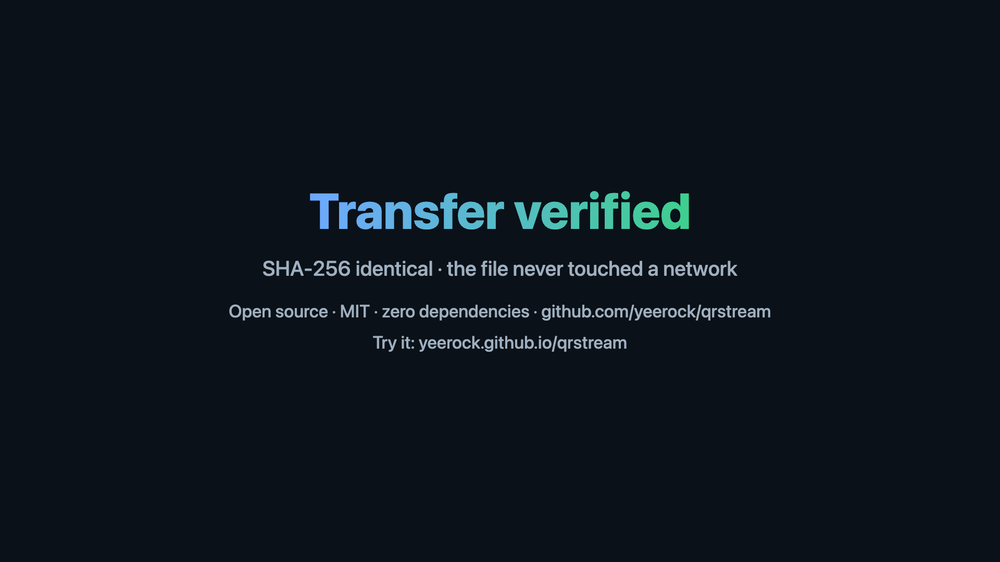
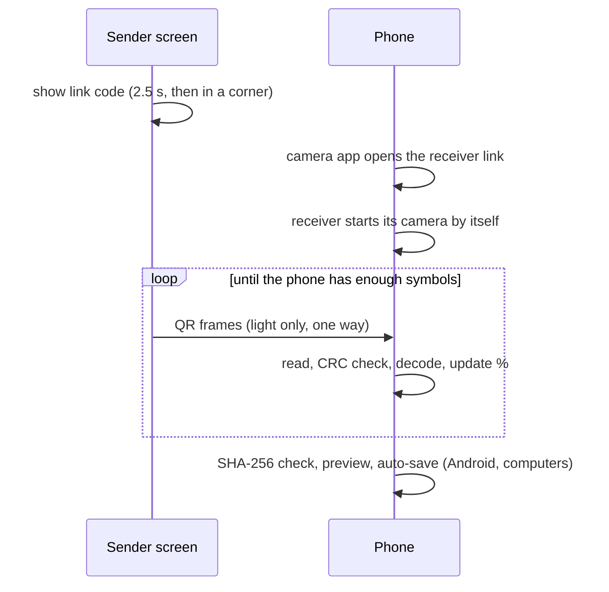

<p align="center"></p>
<h1 align="center">QRStream</h1>
<p align="center"><sub>by <a href="https://vyrox.com/">VYROX</a></sub></p>
<p align="center"><b>Send any file from a screen to a phone as a video of QR codes.</b><br>
One way · no network · no pairing · no app · no upload · <b>zero dependencies</b> · SHA-256 checked · fully automatic</p>
<p align="center">
<a href="https://yeerock.github.io/qrstream/"><b>▶ Live demo</b></a> ·
<a href="https://yeerock.github.io/qrstream/send/">Sender</a> ·
<a href="https://yeerock.github.io/qrstream/receive/">Receiver</a> ·
<a href="docs/METHODOLOGY.md">Methodology</a> ·
<a href="https://yeerock.github.io/qrstream/#demo">Demo video</a>
</p>

[](https://yeerock.github.io/qrstream/#demo)

*The demo video is a real test run: the sender's stream is filmed by a simulated camera (tilt, blur, noise, uneven light), Chrome uses it as its webcam, and the real receiver rebuilds the file and matches its SHA-256. Nothing is mocked.*

---

## Contents

1. [What it is](#what-it-is)
2. [How it works](#how-it-works)
3. [Smart mode: automatic, no settings](#smart-mode-automatic-no-settings)
4. [How to use it](#how-to-use-it)
5. [Use cases, and when not to use it](#use-cases)
6. [Specifications](#specifications)
7. [Measured performance](#measured-performance)
8. [The erasure code](#the-erasure-code)
9. [The QR reader](#the-qr-reader)
10. [Frame format](#frame-format)
11. [Security and privacy](#security-and-privacy)
12. [Run it, embed it, test it](#run-it-yourself)
13. [Project layout](#project-layout)
14. [Limits and roadmap](#limits-and-roadmap)

---

## What it is

QRStream moves a file from any screen to a phone **with no network link at all**. The sender is a web page that turns the file into an endless stream of QR codes. The receiver is a web page on the phone that films the screen, rebuilds the file, checks it with SHA-256, and lets you **Open, Save, Share** (through the phone's own share sheet: AirDrop, Messages, WhatsApp, Files, Photos) or **Email** it.

| | |
|---|---|
| **One-way link** | The sender only shows pictures; the receiver only looks. Nothing travels back, so there is nothing to pair, connect or attack over a network. |
| **Every frame counts** | A rateless erasure code: a missed or blurred frame costs a fraction of a second, never a restart. Any set of symbols about 2 % larger than the file rebuilds it. |
| **Automatic** | Smart mode measures the screen and tunes itself. The phone opens from a link code, starts its camera, and saves the file without being told. |
| **Own code, zero dependencies** | QR encoder, QR reader, erasure code, previews, test driver: all written for this project. No npm packages, no CDN, no build step. |
| **Private** | Static pages and a strict Content-Security-Policy. The file never leaves the two devices except as light. Works offline after one visit (PWA). |

---

## How it works

```mermaid
flowchart LR
  F[File] --> Z{Compressible?}
  Z -- yes --> G[gzip]
  Z -- no --> P
  G --> P[Pack: name, type, SHA-256 + bytes]
  P --> B[142-byte blocks]
  B --> E[Erasure code: endless symbols]
  E --> FR[Frames: header + symbols + CRC-32]
  FR --> T[Base45 text]
  T --> Q[QR codes v10 to v40, 1 to 8 per screen]
  Q --> S((Screen))
  S -. light .-> C((Phone camera))
  C --> W[Worker pool: own QR reader]
  W --> K[CRC-32 check]
  K --> D[Erasure decoder]
  D --> U[gunzip]
  U --> H[SHA-256 check]
  H --> O[Preview · Open · Save · Share · Email]
```



1. **Pack.** The file (gzipped first if that saves at least 10 %) is packed with its name, type and SHA-256, then cut into 142-byte blocks.
2. **Encode.** The erasure code turns the blocks into an endless stream of symbols. The first symbols are the file itself; after them, every symbol is a fresh combination.
3. **Frame.** Up to 20 symbols go into one frame with a 20-byte header and a CRC-32, written as Base45 text, the densest text a QR code holds reliably.
4. **Show.** Each frame becomes a QR code (own encoder, ISO/IEC 18004). Smart mode places 1 to 8 codes in one or two rows and plays 10 to 15 screens a second.
5. **Film.** The phone films the screen. A pool of Web Workers runs our own QR reader on each camera picture, about 25 ms for three codes in a 1080p frame.
6. **Rebuild.** Frames that fail the CRC are dropped. The decoder solves for the blocks as symbols arrive, by incremental Gaussian elimination per generation: each symbol is reduced against the rows already held as it arrives.
7. **Prove.** The file is unzipped and its SHA-256 must match. Then it appears in the camera box, ready to use.



---

## Smart mode: automatic, no settings

There is no back channel, so the sender cannot ask the phone what it reads best. Instead the stream **optimises itself**:

1. **The sender measures its own screen** in real device pixels, and lists every layout whose modules are at least 3 device pixels wide, at least 2 CSS pixels wide (physical size, so a high-density phone screen does not get codes too small to film), and that fits what a phone camera resolves in one picture (560 × 315 modules). A layout is a QR version from 10 to 40 in **one or two rows of 1 to 4 codes, so up to 8 codes a screen**. The shape that carries the most on that screen wins: a wide screen is filled by two rows of four smaller codes, a square one by a 2 × 2 grid, a laptop by two large codes.
2. **It picks three tiers:**
   * **A**: the highest-capacity layout with modules of at least 4 px (fast).
   * **B**: the best layout below A with at least 5 px (safer).
   * **C**: a layout with at least 7 px (safe).
3. **It weaves them into one stream**, `A A A B A A B C`, at 15, 12 and 10 codes a second.
4. Because every frame carries fresh erasure-coded data, **nothing is wasted**. A good camera reads everything and runs near A's speed; a weak camera reads only B and C and still finishes. There's no probing and no waiting.
5. **The phone coaches only when needed.** It knows which frame sizes it decodes. If only the safe tier gets through, it asks the user to move closer or hold steady. If it sees nothing, it suggests reducing glare.
6. **Entry is automatic.** The link code fills the stage for the first 2.5 s and then stays in a corner of the sender bar (click it to show it large for 5 s), so a phone can join at any moment and the stream loses no time to it. The phone's camera app opens the receiver, which starts its own camera. On Android and computers, common pictures, video, audio, PDF and text files save at once; any other type waits for a tap, and iPhone always needs one tap (Apple's rule for downloads).
7. **Both sides show what is happening.** The sender shows the time shown, the pass number, the time a phone needs, the top speed and a check code; it turns green once a phone that saw everything has enough. The receiver shows percent, bytes, live KB/s and time left, and the final speed on the result.

Examples measured by the sender itself:

| Screen | Smart chooses |
|---|---|
| 2560 × 1440 monitor | 4 × 2 grid of QR v28 (8 codes), up to 131 KB/s |
| 1920 × 1080 monitor | 4 × 2 grid of QR v23 (8 codes), safer layouts woven in, up to 87 KB/s |
| 1440 × 900 window, 2 device pixels per CSS pixel | 4 × 2 grid of QR v28, up to 128 KB/s |
| 1440 × 900 window, 1 device pixel per CSS pixel | 2 × QR v38, up to 53 KB/s |
| 1080 × 1080 square screen | 2 × 2 grid of QR v21, up to 37 KB/s |
| 390 × 844 phone, 3 device pixels per CSS pixel | 2 stacked QR v21, up to 19 KB/s |
| 390 × 844 window at 1 device pixel per CSS pixel | 1 × QR v15 |

The rates are the sender's own figure for a camera that reads every code: the bytes of one round of the weave over the time that round takes (about 13 screens a second).

Manual levels remain for lab use:

| Level | Codes per second | Bytes per code |
|---|---|---|
| **Smart (default)** | 15 / 12 / 10, mixed | best fit, 1 to 8 codes |
| Extreme+ / Extreme | 30 / 20 | 2,840 (v40) |
| Turbo / Max | 15 / 12 | 2,840 (v40) |
| High / Medium / Low | 12 / 10 / 8 | 1,846 / 1,136 / 426 |

---

## How to use it

1. On the computer or kiosk, open **[Send](https://yeerock.github.io/qrstream/send/)** and choose a file (or *Use a demo picture*).
2. Point the phone camera at the screen. The link code opens the **[Receiver](https://yeerock.github.io/qrstream/receive/)**, which starts its camera by itself.
3. Hold the phone so the codes fill most of the view. The percent climbs. When the file checks out it is shown in the camera box with **Open · Save · Share · Email**.

No live camera? Record the screen with any phone, then use **Use a Video of the Code** on the receiver.

The receiver previews pictures, video, text, and the start of Word, Excel and PowerPoint files (own ZIP and XML reader). A PDF shows a card, and **Open** uses the phone's own PDF viewer. The last 20 files stay in the browser's storage on that phone.

---

## Use cases

- **Isolated and high-security systems:** export a report, log or key from a machine that must never join a network, without USB media.
- **Kiosks, HMIs, CCTV/NVR monitors, medical carts, POS:** devices with a screen but no easy export.
- **Field sites with no signal:** mines, ships, plants, basements. The receiver runs offline.
- **Evidence capture:** hand a still, a short clip or a PDF to an inspector's phone, with a SHA-256 that proves it was not changed.
- **Guests and BYOD:** share a file without Wi-Fi passwords, apps, accounts or email addresses.
- **Classrooms, demos, events:** one projector, any number of receivers at once.

**Good fit:** files up to a few MB; a screen and a camera, with no shared network or one you must not use.

**Use something else:** for tens of MB or more; when you need two-way communication; for very small screens with poor cameras; for secret data on a screen others can film (anyone in view can receive it, so encrypt first).

---

## Specifications

| Item | Value |
|---|---|
| Symbol | QR Model 2 (ISO/IEC 18004), error level L, versions 10 to 40 (manual levels use 15 to 40), own encoder |
| Payload text | Base45 (RFC 9285) in QR alphanumeric mode: 2 bytes in 3 characters |
| Erasure code | Systematic random linear fountain over GF(2), generations of 1,024 blocks, interleaved sources, incremental Gaussian elimination with bounded memory |
| Symbol size | 142 bytes, the same at every QR version, so density changes lose nothing |
| Frame | 20-byte header + up to 20 symbols = 2,840 bytes per code at QR v40 |
| Codes per screen | 1 to 8: one or two rows of 1 to 4 codes; 4-module quiet zone |
| Rate | 8 to 30 codes per second (Smart: 10, 12, 15) |
| Raw throughput per code | v40: 42 KB/s at 15/s · v33: 22 KB/s · v25: 11 KB/s · v15: 3.3 KB/s |
| Integrity | CRC-32 per frame; CRC-32 of the metadata and of each body chunk (to find damage); SHA-256 of the whole file |
| Compression | gzip (browser CompressionStream) when it saves ≥ 10 % |
| Reader | Own QR reader in 1 to 3 Web Workers, camera frames scaled to ≤ 1,920 px |
| Limits | Sender 10 MB; receiver refuses streams over 16 MB, gzip output over 64 MB |
| Offline | Service worker; the receiver works with no signal after one visit |
| Browsers | Sender: any modern browser. Receiver: Chrome, Edge, Firefox, Safari 16.4 or later, with a camera; https or localhost |
| Dependencies | **None.** Node 22+ and Chrome for the tests only |

---

## Measured performance

All measured through the **real camera path**: the real sender page, our camera simulator, Chrome's fake webcam, and the real receiver page.

| Test | Result |
|---|---|
| 300 KB random file, Smart mode, 1080p screen | **4.5 s (65 KB/s)** |
| 300 KB random file, Smart mode, 720p screen | 7.0 s |
| 300 KB, 1 / 2 / 3 codes per screen at 10 screens/s | 11.9 / 6.8 / 4.7 s |
| 300 KB, 3 codes, 30 screens/s (Extreme+) | **2.1 to 2.3 s (128 to 137 KB/s)** |
| 334 KB log file (gzip) | **0.9 s** |
| Hostile HTML file | arrives as `text/plain`, never runs |

Engine figures:

| Measure | Value |
|---|---|
| Extra symbols needed at 20 to 50 % frame loss | **1.6 to 4 %** |
| QR reader, three v40 codes in a 1080p frame | **≈ 25 ms** |
| QR encoder, one v40 frame | ≈ 0.5 ms |

---

## The erasure code

* **Systematic:** symbols `0 … K-1` are the source blocks themselves. With no loss, one pass is enough.
* **Interleaved:** source symbol *i* carries block *(i · p) mod K*, with *p* coprime to *K*. A lost frame then costs every generation a little, instead of one generation a lot.
* **Repair symbols:** each belongs to one generation of 1,024 blocks, chosen in proportion to generation size, and is the XOR of a pseudo-random half of that generation. Row bits come from a non-linear hash (MurmurHash3 `fmix32`); a GF(2)-linear generator such as xorshift cannot reach full rank.
* **Decoding:** incremental Gaussian elimination over GF(2) per generation. Each arriving symbol is reduced against the pivot rows already held; it becomes the pivot of one more block or is dropped as redundant. A generation therefore holds at most one 272-byte row per block, in one array, whatever arrives, and it is solved by one back-substitution the moment its rank is full. Measured in Node on a desktop: a 10 MB file at 20 % frame loss decodes in 0.8 s of CPU with the slowest frame at 4 ms; a phone that joins a 3 MB stream after every source symbol has passed needs 0.7 % extra symbols and 15 MB of memory (the earlier decoder needed about 600 MB there).
* **Result:** 1.6 to 4 % extra symbols at 20 to 50 % frame loss. An earlier LT design with a robust soliton distribution needed 24 to 43 %.

Background: random linear network coding (Ho et al., IEEE Trans. Inf. Theory 52(10), 2006, doi:10.1109/TIT.2006.881746); generation coding (Chou, Wu and Jain, Allerton 2003); LT codes (Luby, FOCS 2002, doi:10.1109/SFCS.2002.1181950); RaptorQ inactivation decoding (RFC 6330).

---

## The QR reader

Written for this stream (`core/qrread.js`):

1. **Binarise:** a local threshold per 8×8 block, taken over its 5×5 neighbourhood and weighted by contrast, so blank white areas between stacked codes do not pull it toward white; the weighting fades out where white clips (an overexposed screen). It handles glare and uneven light.
2. **Finder patterns:** row scans for 1:1:3:1:1 runs, confirmed vertically, horizontally and diagonally.
3. **Triangles:** three finders forming a right isosceles triangle with matching module size, ranked by geometry and confidence. Several codes per picture work.
4. **Size from timing patterns:** count the runs along module row 6 and column 6. A code of size *d* has exactly *d − 12* runs. This works under any perspective and rejects false triangles cheaply. Blurred timing modules that shrink to one pixel are merged only inside one module, and a second count on the grey picture gives a second opinion; this removed nearly all misses on stacked and grid layouts. It made the reader 5× faster.
5. **Grid lock:** fast lock on six well-spread alignment patterns with a least-squares homography (normalised DLT). If needed, a full lock visits every alignment pattern nearest the finders first, then samples with one map per cell (lens distortion, curved screens). Alignment is refined to 1/8 module.
6. **Decode:** format and version by nearest BCH code word, unmask, de-interleave, then Reed-Solomon per block (Berlekamp-Massey, Chien search, Forney).

Tested with rotation, 180°, perspective, blur, sensor noise, uneven light, three codes per picture, stacked codes, 2 × 2 grids, a grid with the small entry code beside it, and 120 damaged modules. On synthetic camera pictures the reader misses none of 7,560 codes across seven layouts and reads down to about 2.5 px per module; Smart mode still keeps 3 px as its floor.

---

## Frame format

| Bytes | Field |
|---|---|
| 0–1 | Magic `A5 51` |
| 2 | Format version (3) |
| 3 | Reserved |
| 4–7 | Stream id (random per transfer) |
| 8–11 | Packed length |
| 12–15 | Seed of the first symbol |
| 16–19 | CRC-32 of the frame (computed with these 4 bytes skipped) |
| 20… | *n* symbols of 142 bytes, seeds `seed … seed+n-1` |

A packed transfer is `[u16 JSON length][JSON {name, mime, sha256, size, z?, title, at}][body]`. The text ends with `/`, so no reader trims a trailing space.

---

## Security and privacy

| Threat | Mitigation |
|---|---|
| A hostile file runs script when opened | MIME allowlist: HTML, SVG, XML and JavaScript open as `text/plain`, unknown types as bytes. Tested end to end with a hostile HTML file. |
| Data leaves the device | No server. Strict CSP: `default-src 'self'`, `connect-src 'self'`, `object-src 'none'`, `base-uri 'none'`, `form-action 'none'`, no referrer. |
| Hostile streams that never complete | The decoder holds at most one row per block and does one reduction per symbol: 60,000 crafted symbols on a forged 16 MB stream cost 18 MB and 0.1 ms each in the test. |
| Misread or corrupted frames | Magic, version and CRC-32 checks (a CRC stops misreads, not a forger: see the rows on another screen and on a wrong file). A length under 3 bytes or over 16 MB is ignored. Malformed metadata is rejected. |
| Another stream in view | The receiver switches streams only after 3 different frames of the new one, over at least 0.4 s, with none of the current stream in between. The interrupted transfer is parked, not dropped, and goes on when its screen comes back. A file that fails its check 5 times stops the camera with a clear message. |
| Wrong file shown by a hostile screen | SHA-256 proves error-free delivery, not origin. Both screens show a 16-character check code (the start of the SHA-256; the receiver shows the full value on a tap). It rules out a mix-up; for anything that matters compare the full SHA-256. |
| Unwanted downloads | Only common picture, video, audio, PDF and text types save by themselves; other types wait for a tap. |
| Misleading names | Control and direction-override characters are removed from the title and name. |
| Framing (clickjacking) | The first script on every page hides it when another site frames it. |
| A damaged symbol that passes the frame CRC | The sender adds a CRC-32 of the metadata and of each body chunk. On a failed check the receiver forgets only the damaged blocks and keeps reading. Small files and light damage recover in a few frames; for a multi-megabyte file it costs about one more pass, because repair symbols are spread over the whole file (a property of the format). |
| Decompression bombs | gunzip is streamed and capped at 64 MB; document previews count the inflated bytes and stop at 4 MB. |
| Unsafe file names | Reduced to `[A-Za-z0-9_.-]`, no leading dots, at most 120 characters. |
| Supply chain | No third-party code, no CDN, no npm packages, no build step. |
| Shoulder surfing | Inherent to light: anyone filming the screen receives the file. Encrypt first for secrets. |

---

## Run it yourself

It's all static files: host the folder anywhere with HTTPS (the camera needs HTTPS or localhost).

```bash
git clone https://github.com/yeerock/qrstream && cd qrstream
node tests/serve.mjs 8787      # http://localhost:8787/
```

### Embed the codec

`core/qrtx.js` (encoder, erasure code, framing) and `core/qrread.js` (reader) are dependency-free UMD files: browser globals `QRTX` and `QRREAD`, or `require` in Node.

```js
// sender
const data = QRTX.pack({ name, mime, sha256, size }, bytes);
const stream = new QRTX.Stream(data, crypto.getRandomValues(new Uint32Array(1))[0]);
const text = stream.next(40);                           // payload of the next code at QR version 40
const qr = QRTX.encode(text, { version: 40, mask: 2 });  // { size, m: Uint8Array(size*size) }, 1 = dark

// receiver
const texts = QRREAD.read({ data, width, height }, 4);   // every code in a camera picture
for (const t of texts) {
  const f = QRTX.parseFrame(t);                          // null if not ours or corrupted
  if (!f) continue;
  collector ??= new QRTX.Collector(f.id, f.len);
  collector.add(f);
}
if (collector?.done) { const { meta, file } = QRTX.unpack(collector.bytes()); /* gunzip if meta.z, check meta.sha256 */ }
```

### Tests

No packages to install: Node 22+ and Google Chrome.

```bash
npm test             # codec, reader (32 picture cases), decoder (edge sizes, late join, hostile stream), repair (damaged symbols)
npm run ui           # the pages in a real browser: sender controls, text sending, reduced motion, framing, a second stream in view
npm run e2e:wide     # the same on a Full HD sender, where Smart mode shows 8 codes a screen
npm run e2e          # sender -> simulated camera (.y4m fake webcam) -> receiver; SHA-256 must match
FILE=tests/fixtures/hostile.html EXPECT_TYPE=text/plain npm run e2e   # a hostile HTML file arrives inert
FILE=some.bin K=3 LVL=0 FPS=30 npm run e2e                            # 3 codes, Extreme+, 30 screens/s
BASE=https://yeerock.github.io/qrstream npm run e2e                   # test the deployed site
npm run demo-video   # rebuild docs/demo.webm from a real run (Chrome MediaRecorder)
```

The tests drive Chrome through our own DevTools Protocol client (`tests/cdp.mjs`). The camera simulator (`tests/camera.mjs`) writes raw `.y4m` frames that Chrome uses as its webcam.

---

## Project layout

```
core/qrtx.js        QR encoder, Base45, CRC-32, erasure code, framing (shared by both sides)
core/qrread.js      QR reader: binarise, finders, timing, grid lock, homography, Reed-Solomon
send/               sender page (Smart mode)
receive/            receiver PWA (camera, worker pool, coach, preview, share, offline service worker)
docs/               METHODOLOGY.md (full design and measurements), demo.webm
tests/              codec + reader tests, camera-path end-to-end test, CDP driver, camera simulator, static server
demo/               builds docs/demo.webm from a real end-to-end run
```

---

## FAQ and troubleshooting

* **Send text?** Open *Send text instead* on the sender, or paste. A copied picture can be pasted too.
* **Several files?** One at a time: put them in one zip file.
* **Stuck or slow?** Fill the camera view with the screen, hold still, tilt a little against glare, raise the screen brightness. If only the slower codes get through, move closer.
* **The phone looked away.** Point it back; what was read is kept. *Stop* keeps it too, until *Discard*.
* **Dark room or a dim panel?** Phones that allow it show a *Light* button for the torch.
* **Keyboard on the sender:** Space pauses, F is full screen, Esc stops.
* **The phone says "move closer".** Every frame carries a mark for its tier (fast, safer, safe), so the receiver knows which kind it is reading; the hint shows only when none of the fast frames get through.
* **Flashing:** the codes flicker quickly. People who set *reduce motion* get a *Start stream* button instead of an automatic start.

## Limits and roadmap

* Not yet measured with physical cameras across phone models. The numbers above come from the camera simulator, which models tilt, blur, noise and light but not rolling shutter or screen flicker. Field results will be added.
* Generations are 1,024 blocks plus a remainder; a small last generation gets few repair symbols and can make the last blocks of some file sizes slow to arrive. Equal-size generations fix this but change the block mapping, so they need a new format version.
* Colour codes (three channels) could triple density again, with a decoder robust to camera white balance.
* An optional optical back channel could make Smart mode closed-loop.

## Licence

MIT. Every line of code in this repository is original; there are no third-party components.
